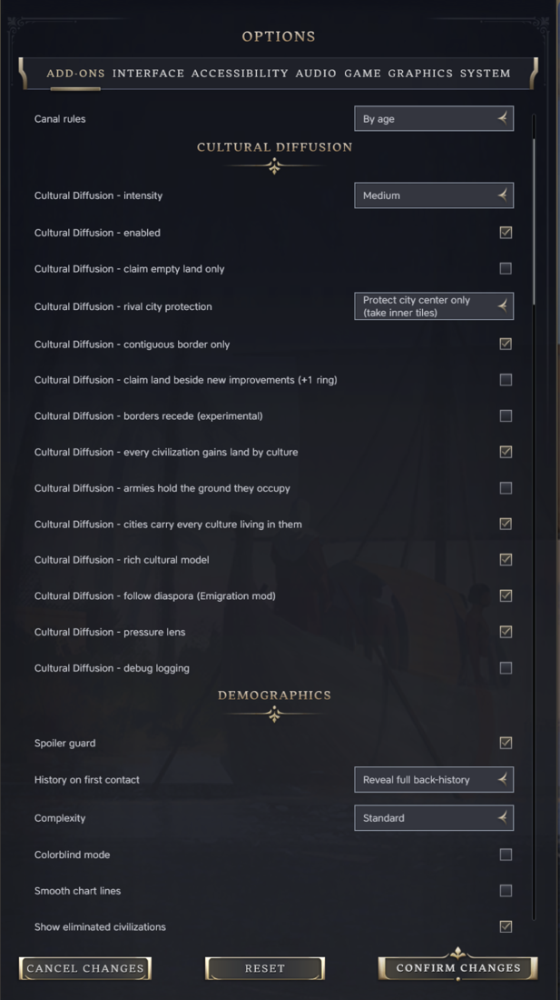
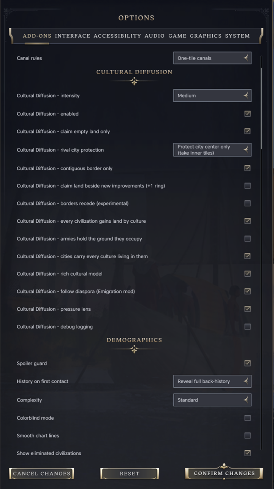
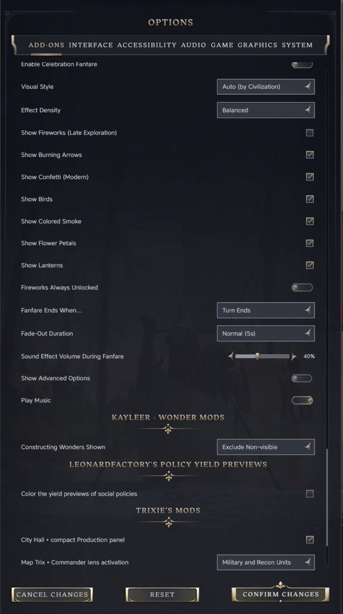
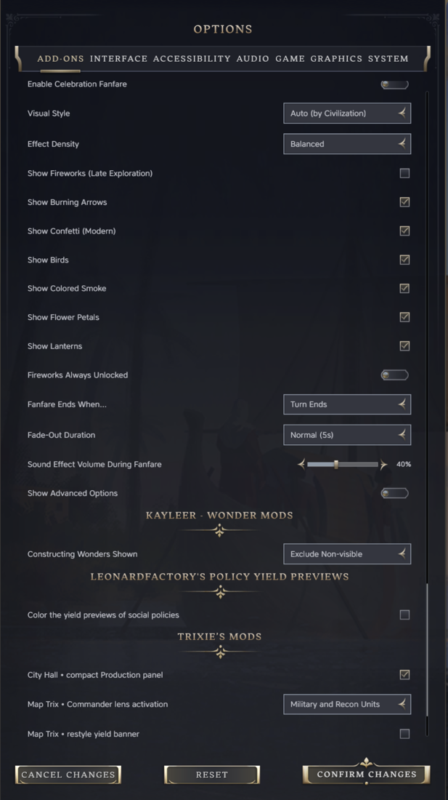
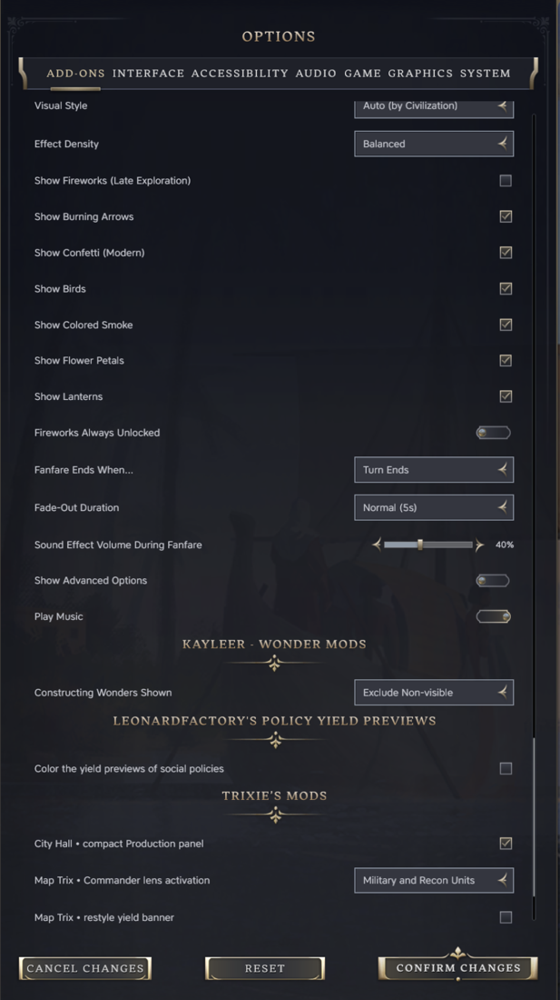
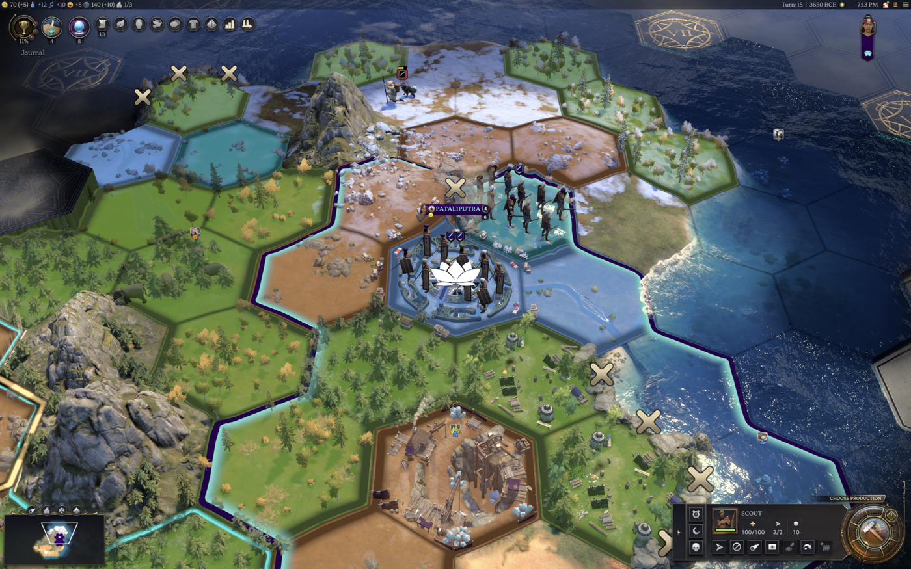
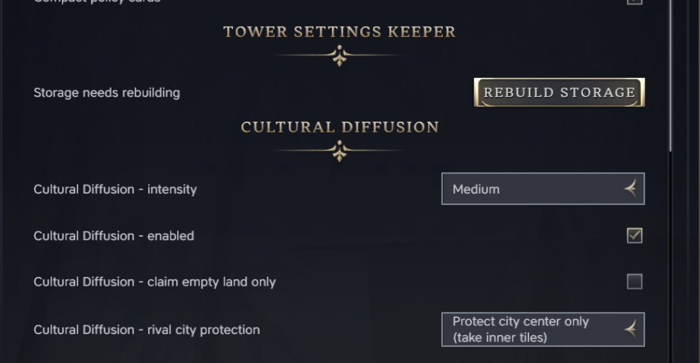
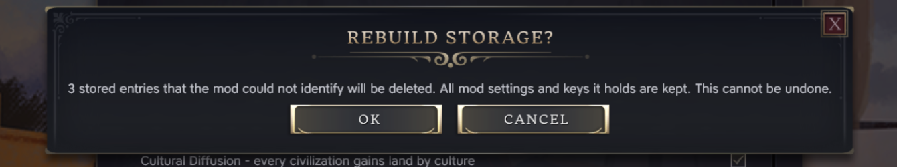
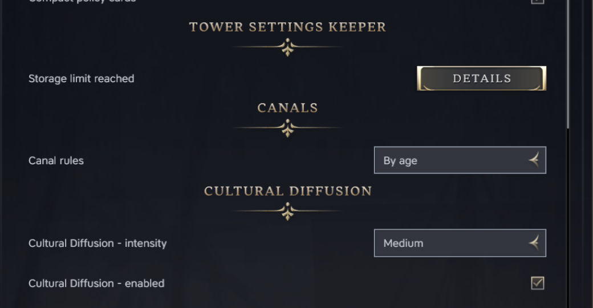
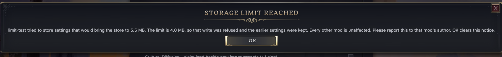

# Tower Settings Keeper

Read this in: [Deutsch](docs/readme/README.de_de.md) · [Español](docs/readme/README.es_es.md) · [Français](docs/readme/README.fr_fr.md) · [Italiano](docs/readme/README.it_it.md) · [日本語](docs/readme/README.ja_jp.md) · [한국어](docs/readme/README.ko_kr.md) · [Polski](docs/readme/README.pl_pl.md) · [Português (Brasil)](docs/readme/README.pt_br.md) · [Русский](docs/readme/README.ru_ru.md) · [简体中文](docs/readme/README.zh_cn.md) · [繁體中文](docs/readme/README.zh_hk.md)

A Civilization VII mod. With it installed, the options you set in other mods stay set after you restart the game.
There's nothing to set up, and gameplay stays the same.

## The problem

Mods keep their settings in the game's `localStorage`. In Civilization VII 1.5.0 that store has a bug. A read returns
the first entry in the store no matter which entry was asked for, and there is no way to list the entries. A mod can
read its own settings only if its entry happens to sort first. Every other mod gets a different mod's data, treats it
as its own, and writes it back under its own name the next time it saves.

Players see options panels that reset between launches, and sometimes one mod's settings showing up inside another.

Most options panels share one entry called `modSettings`, with a section for each mod. About fifty Workshop mods
also include a helper that clears the whole store as soon as it sees a second entry. One mod that stores its
settings under its own entry is enough to wipe every other mod's settings on the next save.

## What the mod does

It keeps every entry inside the one row the game can read, and answers every `localStorage` call from that row.

- A mod that uses its own key gets it stored and read back under that key.
- The shared `modSettings` entry works as before, one section per mod, so existing options panels need no changes.
- The store always reports a single entry, so the clear-on-second-entry helper never runs.
- If another mod has already pushed the store out of order, the mod moves the entries it can identify into place
  and leaves the rest alone. It checks again on every launch.

## Works with every mod, no changes needed

This mod fixes the problem for every mod that stores settings, as those mods are today. Mod authors don't have to
change or register anything. A player who installs this mod gets working settings in all of their mods at once.

Mod authors have one extra option. They can ship the same file inside their own mod, so their players are covered
even if they never install this mod. That's described under For modders below. A mod that ships the file and this
mod can be installed together. Only the newest copy runs, and the others step aside.

## Screenshots

Options changed in the main menu, then read back from the Options screen after a restart:

| Before | After the change | After a restart |
|---|---|---|
|  |  |  |

Options changed during a game, then read back after another restart, in the menu and in a game:

| In game, before | In game, after | Menu, after a restart | Game, after a restart |
|---|---|---|---|
|  |  |  |  |

The other mods use the stored values, not only display them. Map Trix's "Commander lens activation" was set to
Military and Recon Units and saved. In a fresh process, selecting a scout turns on its commander lens. With the
default setting the game's own discovery lens opens instead:

Tested on 1.5.0 with 28 mods, including Map Trix, City Hall, Celebratory Celebrations, Wonders Screen Continued,
Better Ribbon Info, Compact Policy Cards, History and Rankings, a settings manager and AutoMissionary. The full
record is in [docs/design.md](docs/design.md).

## Install

Subscribe on the Steam Workshop, or download the zip from the latest release and unpack it into
`~/Library/Application Support/Civilization VII/Mods/` on macOS or
`%LOCALAPPDATA%\Firaxis Games\Sid Meier's Civilization VII\Mods\` on Windows. Then enable it under Additional
Content, and that's all.

## Things to know

- Settings you save from now on stay. Settings that were lost before you installed the mod are gone, unless they
  are still on disk under an entry the mod can identify.
- If the store was already broken, the mod only moves the entries it can identify. If an entry it can't identify is
  the only one left, the mod rebuilds the store around it and keeps the entry's contents. The entry's name
  is lost. A later version that recognises the contents puts them back under the right name. If two or more such
  entries are in the way, the mod starts a fresh root ahead of them, leaves them on disk, and tries again on the next
  launch. It never overwrites another mod's data.
- The game doesn't guarantee the order mod scripts run in. A mod that reads its settings at the moment its script
  loads, before this mod has run, sees the old behaviour for that one launch. In 112 test launches the keeper started
  ahead of every other mod that logs its start, except once, behind a mod that keeps no settings.
- The mod's own text is translated into all eleven languages the game supports.
- The store has a size limit of 4 MB. In testing it held 0.5 to 0.75 MB, nearly all of it one mod's game history,
  which that mod keeps under 0.5 MB. A mod that tries to go past the limit has that one write refused and keeps its
  earlier settings, and Options, Add-ons shows a "Storage limit reached" row that names the mod. Nothing else is
  affected. See Load and limits below.
- Normally all you'll see is one line in `Logs/UI.log` that starts with `[settings-keeper] ready`. The exception is
  the fallback case above. Then Options, Add-ons shows a "Rebuild storage" row. Press it, confirm, and
  the entries the mod could not identify are deleted and the store is written back as one entry. The row goes away
  once the store is normal.

  | The row, shown only when needed | The confirmation |
  |---|---|
  |  |  |

## Load and limits

Everything lives in one row, so the row's size is the thing to watch. On 2026-10-15, in a game with the 16 Tower
mods on, the row held 776,451 characters (0.74 MB). The part a mod gets back when it reads `modSettings` was 521,244
characters, and 519,264 of those were Demographics' hall of fame, which Demographics keeps under 512 KB. Most of the
rest was one unreleased mod's own key. An options panel adds a few hundred bytes. The number of mods doesn't matter
on its own. What matters is how much they store.

What a read and a write cost at that size, timed in that game (the mean of 20 reads and of 10 writes):

| Step | Time |
|---|---|
| The engine's own read of the whole row | 1.5 ms |
| `localStorage.getItem("modSettings")` through the keeper, which includes that read | 1.9 ms |
| The mod parsing what it got back (`JSON.parse`) | 4.5 ms |
| One read plus parse, as a mod sees it | 6.3 ms (4.8 to 12.4) |
| The mod turning its settings back into text (`JSON.stringify`) | 2.6 ms |
| `setItem`, plus the one engine write the keeper makes at the end of the task | 13.9 ms (11.3 to 16.9) |
| The engine's own write, part of the line above | 1.5 ms |

So a mod that reads, changes one value and writes it back spends about 20 ms, nearly all of it on half a megabyte of
another mod's history. Several writes in the same task still make one engine write. A mod that reads its settings
when its panel opens won't notice. One that reads on every key press or unit selection will, and the fix for that is
in the mod: read once, keep the values, and read again when an option changes. [docs/design.md](docs/design.md) has
the full breakdown and ways to bring the cost down.

To find where the engine gives up, on 2026-10-06 a probe grew the row by 1 MB per step through the keeper in a Play
Now game with the player's 28 mods, and separate launches tried the pieces on their own. The store was 0.5 MB then. A
write here is the keeper's engine write (serialise the row and store it), and a key read is one that has to parse
the row again after a write.

| Row size | One write (serialise and store) | One key read after a write |
|---|---|---|
| 0.5 MB, the real store | 8 ms | 2 ms |
| 5 MB | 71 ms | 20 ms |
| 10 MB | 101 ms | 64 ms |
| 13 MB | 141 ms | 67 ms |
| 16 MB in one write | 102 ms | |
| 20 MB, grown 1 MB at a time | 197 ms | |

Nothing was lost or corrupted at any size, and the store stayed one row throughout. The game process itself has a
ceiling. It stopped, without a crash report, at the 14 MB step when the row was parsed and rewritten several times
in a row, and at the 21 MB step when it was only rewritten. A 14 MB store loaded at the main menu and in a game with
every key readable, and then stopped when the row was re-read and rewritten once more. The process was at 1.9 GB
when it stopped, so the ceiling is the game's memory, not the storage.

The keeper therefore refuses any write that would take the row past 4 MB, a quarter of the lowest size at which the
game stopped. The refused write throws the same `QuotaExceededError` a browser throws when its localStorage is full,
so a mod written against the web API already knows what it means. The mod's earlier value stays, every other mod is
untouched, the log names the mod and the sizes, and Options, Add-ons shows a "Storage limit reached" row with the
same details and an OK that clears it. The limit is one constant at the top of `ui/settings-keeper.js`.

| The row, after a 5 MB write was refused | Its dialog |
|---|---|
|  |  |

Many small values are cheap: on 2026-10-06, with the row at 530 KB, 2000 keys written in one go cost 21 ms, and 200
separate writes 6 ms each. Every read goes back to the engine for the whole row, because that's how the keeper
notices a write made around it. So even a read of a small key of a mod's own costs the engine's read: 0.9 ms a read
then, 1.5 ms on 2026-10-15. A mod that reads thousands of keys in a loop will see that add up, and a mod that reads
`modSettings` pays the parse on top.

## Removing the mod

Usually you can just switch it off. The store is one row, so the game reads `modSettings` first as it did before, and
other mods find their sections. The only extra content is a few internal fields they ignore. If Options shows the
"Rebuild storage" row, press it before you disable the mod. Otherwise the clear-on-second-entry helper in other
mods will wipe the store on its next save.

## For modders

You don't have to do anything. Your mod's settings work with this mod installed, whether your mod uses the shared
`modSettings` entry or its own key, and whatever helper code it uses.

If you want your players covered without them installing this mod, you can ship the fix inside your own mod.
Players then get it without installing anything else. It is one file and two lines in your modinfo, and your
settings code stays as it is. See [embed/README.md](embed/README.md), or
download `settings-keeper-embed-<version>.zip` from the latest release. Several mods can carry the file at once.
The first copy to load installs, later copies find it and step aside, and a newer build replaces an older one.

If your mod stores its settings under its own key and you want already-broken stores repaired for your players,
send the key name and a check that identifies your data. See the `KNOWN_KEYS` list in `ui/settings-keeper.js`. The
mod only moves entries it can identify.

## Licence

MIT.
